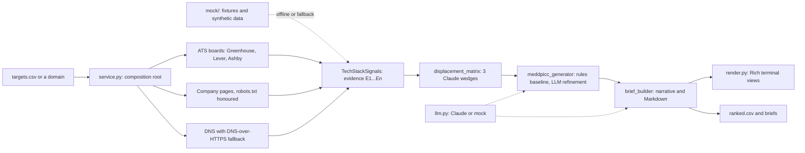

# anthropic-prospector

[](https://github.com/the-gtm-guy/anthropic-prospector/actions/workflows/ci.yml)


**Signal-based prospecting for an Anthropic SDR.** It reads public hiring, web and DNS
signals for West Coast B2B startups (CA, WA, OR, AZ). For each account it produces:

- **a Claude wedge hypothesis:** which Claude feature fits this account and why,
- **a MEDDPICC scorecard:** what is known, what is hypothesized, what to ask next,
- **an outbound brief:** why now, who to call, what to say, and a four-touch sequence.

It runs end to end with **zero keys**: `--offline` uses a fictional sample territory and a
rules-based writer, with no network, no API key and no cost. Add an `ANTHROPIC_API_KEY`
and Claude writes the narrative.

> An independent portfolio project. It is not affiliated with or endorsed by Anthropic.

## Contents

- [Quickstart](#quickstart)
- [Why signals](#why-signals)
- [Commands](#commands)
- [Modes: what is real](#modes-what-is-real)
- [How qualification works](#how-qualification-works)
- [Architecture](#architecture)
- [Using Claude](#using-claude)
- [Data ethics and rate limits](#data-ethics-and-rate-limits)
- [Configuration](#configuration)
- [Development](#development)
- [Limitations and roadmap](#limitations-and-roadmap)

## Quickstart

Python 3.11 or newer:

```bash
git clone https://github.com/the-gtm-guy/anthropic-prospector.git && cd anthropic-prospector
python -m venv .venv && source .venv/bin/activate
pip install -e ".[dev]"
```

Score one account. `lexiconlegal.example` is one of twelve fictional sample companies:

```console
$ prospector qualify lexiconlegal.example --offline
DATA MOCK (illustrative data) · LLM mock ($0, rules-based) · mode offline
Lexicon Legal AI  lexiconlegal.example  CA
MEDDPICC scorecard
╭───────────────────┬────────┬──────────────┬───────────┬──────────────────────────────────────────╮
│ Element           │ Score  │ Status       │ Health    │ Next action                              │
├───────────────────┼────────┼──────────────┼───────────┼──────────────────────────────────────────┤
│ Metrics           │ 4/10   │ hypothesized │ ◐ partial │ Ask for current inference cost and the   │
│                   │        │              │           │ target that would justify a change.      │
│ Economic buyer    │ –      │ unknown      │ ○ unknown │ Identify the CTO or a founder and        │
│                   │        │              │           │ confirm they own the AI budget.          │
│ Decision criteria │ 5/10   │ hypothesized │ ◐ partial │ Ask which criteria a model vendor must   │
│                   │        │              │           │ pass, and who checks them.               │
│ Decision process  │ –      │ unknown      │ ○ unknown │ Ask how they chose their current model   │
│                   │        │              │           │ vendor and how long it took.             │
│ Paper process     │ 4/10   │ hypothesized │ ◐ partial │ Ask whether they can buy through Amazon  │
│                   │        │              │           │ Bedrock and what review it needs.        │
│ Identify pain     │ 7/10   │ hypothesized │ ✓ strong  │ Roughly what share of each prompt is the │
│                   │        │              │           │ same across calls (system prompt,        │
│                   │        │              │           │ retrieved documents, tool definitions)?  │
│ Champion          │ –      │ unknown      │ ○ unknown │ Find the hiring manager for 'Senior ML   │
│                   │        │              │           │ Engineer, Retrieval'.                    │
│ Competition       │ 6/10   │ validated    │ ◐ partial │ Ask what would make them run a           │
│                   │        │              │           │ side-by-side on one workload.            │
├───────────────────┼────────┼──────────────┼───────────┼──────────────────────────────────────────┤
│ Total             │ 55/100 │ 62% known    │ Tier B    │ PURSUE                                   │
╰───────────────────┴────────┴──────────────┴───────────┴──────────────────────────────────────────╯
PURSUE · Tier B · MEDDPICC 55/100 · 62% known · fit 82
Signals are inferred from public data and may be incomplete or out of date. Verify them before
outreach.
```

Every output line says what is real. `DATA MOCK` means illustrative data, and `LLM mock`
means rules-based text at no cost. Each element shows its health as a colour, a glyph and a
word, so the table reads without colour too. Unknown elements are grey, not red: before
discovery most of MEDDPICC is legitimately unknown.

## Why signals

Cold lists fail for two reasons. Most accounts on them are not qualified, and nothing tells
the rep **why now**. This tool starts from evidence instead:

- **Job posts** show what a company is building now: RAG, agents, evals, inference cost,
  plus who they plan to hire and which model APIs they already use.
- **The company's own pages** show the cloud they run on and the vendors they list.
- **DNS** confirms where their apps are hosted.

Every signal keeps the sentence it came from (`E1`, `E2`, …). Every score and every line of
the brief can be traced back to public evidence, or is labelled a hypothesis.

## Commands

| Command | What it does |
|---|---|
| `prospector run DOMAIN` | Full analysis of one account: company and signal cards, wedges, verdict, brief preview. |
| `prospector qualify DOMAIN` | The MEDDPICC scorecard; `--export-brief PATH` writes the outbound brief. |
| `prospector territory-batch CSV` | Qualifies a whole territory concurrently, ranks it, and exports `ranked.csv` plus briefs. |
| `prospector doctor` | Shows detected keys, the mode each command will use, and (`--network`) what is reachable. |

The account card. At 110 columns or wider the account and signal panels sit side by side;
narrower terminals stack them:

```console
$ COLUMNS=120 prospector run quartzdev.example --offline
DATA MOCK (illustrative data) · LLM mock ($0, rules-based) · mode offline
╭─ Account ───────────────────────────────────────────────╮ ╭─ Signals ────────────────────────────────────────────────╮
│ Company    Quartz DevTools                              │ │ Hiring    5 AI/ML of 11 open roles (Ashby 'quartzdev')   │
│ Domain     quartzdev.example                            │ │ Cloud     Google Cloud 75%                               │
│ HQ         San Jose, CA  in territory                   │ │ Models    OpenAI 80% · LangChain 70%                     │
│ Vertical   Developer tools                              │ │ Keywords  code generation ×5 · agents ×4 · evals ×3 ·    │
│ Funding    Series A · $25M raised · last round          │ │           multi step reasoning ×3 · long context ×2      │
│            2026-04-14                                   │ │ Data      MOCK · 4 evidence items · 2026-10-01           │
│ Employees  45                                           │ ╰──────────────────────────────────────────────────────────╯
│ Contacts   none supplied                                │
╰─────────────────────────────────────────────────────────╯
Anthropic wedges
╭─────────────────────┬────────────────┬───────┬───────────────────────────────────────────────────────────────────────╮
│ Wedge               │ Fit            │ Conf. │ Hypothesis                                                            │
├─────────────────────┼────────────────┼───────┼───────────────────────────────────────────────────────────────────────┤
│ Extended thinking ★ │  89 █████████░ │  100% │ Quartz DevTools appears to run multi-step AI work (signals: agent,    │
│                     │                │       │ multi-step or code-generation work; orchestration chains in LangChain │
│                     │                │       │ or LangGraph; quality measured with evals; reasoning over long        │
│                     │                │       │ documents). Extended thinking lets one call plan, check and revise,   │
│                     │                │       │ which can replace brittle chains of calls.                            │
│ Cloud marketplace   │  61 ██████░░░░ │  100% │ Quartz DevTools could buy Claude through Google Cloud Vertex AI on    │
│                     │                │       │ its existing cloud account (signals: runs on a cloud that sells       │
│                     │                │       │ Claude; LLM spend that could move onto the cloud account); commit     │
│                     │                │       │ eligibility must be confirmed with the Anthropic partner team.        │
│ Prompt caching      │  31 ███░░░░░░░ │  100% │ Quartz DevTools appears to send large, repeated context to an LLM     │
│                     │                │       │ (signals: RAG, long-document or support workloads; existing LLM API   │
│                     │                │       │ spend). Prompt caching bills repeated prefixes at a fraction of the   │
│                     │                │       │ input price, so input spend should fall as volume grows.              │
╰─────────────────────┴────────────────┴───────┴───────────────────────────────────────────────────────────────────────╯
PURSUE · Tier C · MEDDPICC 53/100 · 75% known · fit 81
╭─ Outbound brief ─────────────────────────────────────────────────────────────────────────────────────────────────────╮
│ Quartz DevTools: more reliable multi-step agents with Claude extended thinking                                       │
│ Why now                                                                                                              │
│ - Raised a Series A round in Apr 2026 ($25M raised to date).                                                         │
│ - Hiring for 5 AI/ML roles out of 11 openings, including 'Founding AI Engineer, Code Review Agents'.                 │
│ - Building with the OpenAI API and LangChain today.                                                                  │
│ Call opener                                                                                                          │
│ Saw Quartz DevTools is hiring a Founding AI Engineer, Code Review Agents. Claude's extended thinking lets one call   │
│ plan, check and revise before it answers, which often replaces a brittle chain of planner and verifier calls. Is     │
│ that on your radar this quarter?                                                                                     │
│ Sequence  day 0 email → day 2 linkedin → day 5 call → day 9 email                                                    │
╰──────────────────────────────────────────────────────────────────────────────────────────────────────────────────────╯
Signals are inferred from public data and may be incomplete or out of date. Verify them before outreach.
```

A territory, ranked. Progress goes to stderr, and the report goes to stdout:

```console
$ prospector territory-batch targets.csv --offline --states CA,WA,OR,AZ --top 8
DATA MOCK (illustrative data) · LLM mock ($0, rules-based) · mode offline
Ranked accounts: 8 shown of 24
╭───┬──────────────────────────────────────────────────────┬────┬────────┬────────┬──────────┬─────╮
│ # │ Company                                              │ ST │ Rec.   │ Tier   │ MEDDPICC │ Fit │
├───┼──────────────────────────────────────────────────────┼────┼────────┼────────┼──────────┼─────┤
│ 1 │ Lexicon Legal AI                                     │ CA │ PURSUE │ Tier C │       52 │  82 │
│ 2 │ Arroyo Finance                                       │ CA │ PURSUE │ Tier C │       52 │  81 │
│ 3 │ Quartz DevTools                                      │ CA │ PURSUE │ Tier C │       52 │  81 │
│ 4 │ Bluefin Robotics                                     │ CA │ PURSUE │ Tier B │       55 │  76 │
│ 5 │ Tidewater Analytics                                  │ WA │ PURSUE │ Tier C │       49 │  76 │
│ 6 │ Ridgeline Health AI                                  │ OR │ PURSUE │ Tier C │       52 │  73 │
│ 7 │ Cascade Compliance                                   │ WA │ PURSUE │ Tier C │       51 │  73 │
│ 8 │ Rainier Retail AI                                    │ WA │ PURSUE │ Tier C │       51 │  67 │
╰───┴──────────────────────────────────────────────────────┴────┴────────┴────────┴──────────┴─────╯
LLM mock: no tokens, $0.00
Data 24 mock
Wrote prospector-out/ranked.csv and 8 brief(s) to prospector-out/briefs
```

Lexicon Legal AI scores 52 here but 55 in the quickstart. `targets.csv` supplies a contact for it, so its champion becomes a 4/10 hypothesis instead of unknown, and the total is an average over known elements only.

The batch writes `prospector-out/ranked.csv` with every account, and a brief for each
shortlisted one under `prospector-out/briefs/`. Each finished account is also
checkpointed. An interrupted run (Ctrl-C, a dropped network) continues where it stopped:

```console
$ prospector territory-batch targets.csv --offline --resume
```

Export a brief. A path ending in `.md` or `.json` is the file itself; any other path is a
directory to write into:

```console
$ prospector qualify lexiconlegal.example --offline --export-brief briefs/
```

That writes `briefs/lexiconlegal-example.md`, shown in full in
[examples/lexiconlegal-example.md](examples/lexiconlegal-example.md). An existing file is
never overwritten without `--force`, and the check runs before any paid analysis.

Machine-readable output and diagnostics:

```console
$ prospector run tidewater.example --offline --json
$ prospector doctor
```

Useful flags:

| Flag | Commands | Meaning |
|---|---|---|
| `--offline` / `--live` | all but doctor | Illustrative data only, or public data only (see below). |
| `--targets CSV` | run, qualify | Look the domain up in your own targets file. |
| `--state`, `--name` | run, qualify | Qualify a domain that is in no file. |
| `--states CA,WA` | territory-batch | Only these HQ states. |
| `--top N`, `--min-tier B` | territory-batch | Shortlist shown on screen and exported as briefs (`ranked.csv` keeps every account). |
| `--concurrency N` | territory-batch | Accounts analyzed at once (default 4). |
| `--max-cost USD` | territory-batch | Start no new account once estimated Claude spend reaches this. |
| `--no-color` | all | Plain output; `NO_COLOR` is honoured too. |

Exit codes: `0` success, `1` some accounts could not be analyzed (or a doctor check
failed), `2` usage or configuration error.

## Modes: what is real

Data and the LLM are two independent switches:

| | Data | Text (wedge narrative, brief) |
|---|---|---|
| `--offline` | Illustrative: 12 hand-built fixtures, plus deterministic synthetic signals for any other domain. Nothing touches the network. | Rules-based mock, $0 |
| default | Public sources. A target gets illustrative data only when no source answers at all, and says so. | Claude when `ANTHROPIC_API_KEY` is set, else the mock |
| `--live` | Public sources only. A target that cannot be read fails instead. | Same as default |

A reachable company with few visible signals stays a **live** result with few signals. It
is never padded with invented ones. Batches that mix both kinds of record are labelled
`HYBRID`. The shipped sample companies use the reserved `.example` domain and are never
fetched, so they stay illustrative in every mode.

## How qualification works

### 1. Signals become evidence

| Source | What is read | What it can show |
|---|---|---|
| ATS boards | Greenhouse, Lever (US and EU) and Ashby public APIs | Open roles, AI/ML roles, keywords, model APIs and frameworks in use |
| Company pages | `/`, `/careers`, `/jobs`, `/security`, `/trust`, `/subprocessors` | Board links, cloud and model vendors named outright |
| DNS | CNAME chains for the apex, `www`, `app`, `api`; SPF | The hosting cloud; a CDN in front means "unknown", not a guess |

The board is found from the token in your CSV, then from links on the company's own pages,
then from slugs guessed from the name. A guessed board is accepted only if its postings
name the company. Only engineering, data and AI postings count toward signals: a sales
role that mentions SOC 2 says nothing about the product. A sentence repeated across
postings counts once. Several sightings of one signal combine by noisy-OR,
`1 − Π(1 − cᵢ)`, capped at 0.95: public text suggests usage but never proves it.

### 2. Three Claude wedges

| Wedge | Triggered by | Hypothesis |
|---|---|---|
| **Prompt caching** | RAG, long documents, support workloads, existing LLM API spend, inference cost as a stated priority | Repeated prefixes (system prompts, retrieved documents, tool definitions) bill at a fraction of the input price on cache reads. |
| **Extended thinking** | Agents, multi-step or code-generation work, LangChain/LangGraph chains, evals | One call can plan, check and revise, replacing brittle chains of calls. |
| **Cloud marketplace** | Workloads on AWS, Google Cloud or Azure | Buy Claude through Amazon Bedrock, Google Cloud Vertex AI or Microsoft Foundry on the existing cloud account. Commit eligibility is always "confirm with the Anthropic partner team", never promised. |

Each wedge's fit (0–100) is a weighted sum of trigger strengths, and each trigger carries
the evidence IDs behind it. The account's overall fit is `0.7 × top + 0.3 × second`.

Some accounts get no primary wedge or a different route:

| Case | What happens |
|---|---|
| Already references Claude or Anthropic | Routed to the account team |
| Shows no AI signal | No primary wedge |
| No wedge reaches a fit of 30 | No primary wedge |
| Headquartered outside the territory | Wedge kept, routed to the owning rep |

### 3. MEDDPICC, honestly scored

| Element | Weight | Before discovery |
|---|---:|---|
| Identify pain | 20 | Hypothesized from the top wedge's fit, capped at 8/10 |
| Metrics | 15 | Hypothesized from cost and scale signals, capped low |
| Economic buyer | 15 | Unknown; the next action names the likely buyer for the company's size |
| Champion | 15 | Unknown unless you supply a contact; the next action names the hiring manager behind an AI posting |
| Decision criteria | 10 | Hypothesized from security, latency and eval language in postings |
| Decision process | 10 | Unknown: it becomes a discovery question |
| Competition | 10 | **Validated** when public evidence names the incumbent |
| Paper process | 5 | Hypothesized from the cloud marketplace path |

- **Health:** green is 7–10, yellow 4–6, red 0–3, and grey means unknown.
- **The total:** a weighted average over **known** elements only. Unknowns lower
  *coverage*, not the score.
- **Tiers:** A needs 70+ with half the elements known; B 55+ with 37.5% known; C 40+ with
  25% known.
- **Claude's limits:** Claude may sharpen rationales and discovery questions. It may never
  change a score or invent knowledge. It can mark an element *validated* only by citing
  evidence IDs that exist.

The recommendation, in order:

1. **Route to AE** when the account is an existing Claude user.
2. **Route to owner** when it is outside the territory.
3. **Disqualify** when there is no AI signal.
4. **Pursue** when the primary wedge has a fit of 60+ and the tier is above D.
5. **Nurture** otherwise.

### 4. The outbound brief

A brief contains:

- a headline and why-now bullets
- a talk track and a call opener
- target personas with title patterns
- a four-touch sequence: email on day 0, LinkedIn on day 2, a call on day 5, email on day 9
- objection handling and discovery questions
- the full evidence list and a verification disclaimer

Briefs built from illustrative data carry an **ILLUSTRATIVE DATA** banner.

## Architecture



The layering is enforced by [tests/test_import_dag.py](tests/test_import_dag.py), which
parses every import:

| Layer | May import | Notes |
|---|---|---|
| [models.py](src/anthropic_prospector/models.py) | nothing in the package | Pydantic v2 contracts |
| [config.py](src/anthropic_prospector/config.py) | the package root | Settings from env or `.env` |
| [mock/](src/anthropic_prospector/mock), [scrapers/](src/anthropic_prospector/scrapers), [pipeline/](src/anthropic_prospector/pipeline) | models, config | Independent of each other: the pipeline never fetches, and the scrapers never score |
| [service.py](src/anthropic_prospector/service.py) | all of the above | The only module that wires them together |
| [render.py](src/anthropic_prospector/render.py) | models, config | The only module that imports Rich |
| [cli.py](src/anthropic_prospector/cli.py) | service, render | The only module that imports Typer; no business logic |

Two consequences of this layering:
- **Mock and live data are interchangeable** behind the same contract, so the pipeline
  cannot tell them apart.
- **The deterministic core never depends on the LLM.** If a Claude call fails, the account
  is still qualified with the rules-based text, and the error is reported with it.

## Using Claude

```bash
export ANTHROPIC_API_KEY=sk-ant-...     # or put it in .env
prospector doctor                        # confirms the key is set and which model runs
```

Any `prospector` command run with a key set, and without `--offline`, uses Claude.

- **Model:** `claude-sonnet-5-5` by default; set `ANTHROPIC_MODEL` to change it.
- **Structured outputs:** answers are requested as JSON-schema structured outputs and then
  validated against the Pydantic models. A failed validation gets one retry that includes
  the validation error.
- **Prompt caching:** the system prompt holds the MEDDPICC rubric and the wedge playbook.
  It is static and identical for every account, so in a batch it is written to the cache
  once and read from it afterwards. `territory-batch` reports cache-read tokens and the hit
  rate. The tool uses the same prompt-caching wedge it pitches.
- **Untrusted text:** scraped text is treated as data. It is delimited, escaped so it
  cannot open or close prompt blocks, and the model has no tools.
- **Cost:** estimated per call from a price table. `--max-cost` stops a batch from
  starting new accounts once the budget is spent.

The Claude client is tested against the official SDK through a mocked HTTP transport;
CI has no API key.

## Data ethics and rate limits

- **Public sources only:** public job-board APIs, a company's own public pages, and DNS.
  No logins, no paywalls, no headless browser.
- **No personal data collection:** no people search and no email guessing. Contacts come
  only from the CSV you supply.
- **`robots.txt` is honoured** for company pages, and a 401 or 403 on it disallows the
  whole site.
- **Polite by construction:**
  - an identifying User-Agent (`anthropic-prospector/<version>`)
  - at most 5 requests at once overall and 2 per host
  - at least 0.25 s between requests to the same host
  - three attempts with exponential backoff and jitter, honouring `Retry-After` (capped
    at 30 s)
- **Cached:** answers (200 and 404) are kept on disk for 24 hours, so reruns and resumed
  batches do not refetch.
- **Bounded:** pages are read up to 1 MB and job boards up to 8 MB. A larger Greenhouse
  board falls back to its titles-only listing.
- **Labelled:** every record carries `data_source`, every screen has the data banner, and
  every brief ends with "verify before outreach". The sample companies are fictional and
  live on the reserved `.example` domain.

## Configuration

Every value is optional; see [.env.example](.env.example). Empty values count as unset.

| Variable | Default | Purpose |
|---|---|---|
| `ANTHROPIC_API_KEY` | unset | Enables Claude; without it the mock writes the text |
| `ANTHROPIC_MODEL` | `claude-sonnet-5-5` | Model for live calls |
| `PROSPECTOR_CACHE_DIR` | `~/.cache/anthropic-prospector` | HTTP cache location |
| `PROSPECTOR_CACHE_TTL_HOURS` | `24` | Cache lifetime (`0` disables it) |
| `PROSPECTOR_HTTP_CONCURRENCY` | `5` | Requests in flight overall |
| `PROSPECTOR_PER_HOST_CONCURRENCY` | `2` | Requests in flight per host |
| `PROSPECTOR_HTTP_CONNECT_TIMEOUT_S` / `_READ_TIMEOUT_S` | `5` / `15` | Timeouts |

To qualify your own territory, copy [targets.csv](targets.csv) and replace the rows. The
required columns are `company_name`, `domain` and `hq_state`. Everything else is optional.
For example, `ats_board_token` saves the board search, and a contact enables the champion
and economic-buyer angles.

## Development

```bash
pytest                      # the full suite, offline (live tests are opt-in)
pytest -m live              # smoke tests against real public job boards
ruff check . && ruff format --check . && mypy
```

The test suite pins three kinds of output, each refreshed by its own command:

| Pinned output | Refresh after an intended change |
|---|---|
| Golden scores for the 12 fixtures | `UPDATE_GOLDEN=1 pytest tests/test_golden.py` |
| Terminal snapshots at 60, 80 and 120 columns | `UPDATE_SNAPSHOTS=1 pytest tests/test_render.py` |
| The README examples and the sample brief | `UPDATE_README=1 pytest tests/test_readme.py` |

The README test runs every `$ prospector …` example in this file and compares its output.

CI runs the following on every push:
- lint and strict typing
- tests on Python 3.11, 3.12 and 3.13
- tests on the lowest supported dependency versions
- a check that the built wheel ships its data files

## Limitations and roadmap

**Limitations.**
- **No JavaScript rendering:** pages built in the browser yield little text. They are
  reported as such, not guessed at.
- **English keyword rules:** the signal vocabulary is word-bounded and tested against
  false positives, but it is still a vocabulary.
- **Missed boards:** a company with an unsupported ATS (Workday, iCIMS), or none, shows
  no hiring signals.
- **MEDDPICC is mostly hypotheses before discovery,** by design.
- **Prices can drift:** cost estimates come from a static price table.

**Roadmap.**
- Call-notes ingestion, so discovery answers can validate MEDDPICC elements.
- A scheduled batch that diffs `ranked.csv` against the last run and flags accounts whose
  signals changed.
- Export to a CRM.
- More ATS adapters.

See [CAROUSEL_DECK.md](CAROUSEL_DECK.md) for the LinkedIn carousel that presents the
project.

Release notes are in [CHANGELOG.md](CHANGELOG.md).

## License

MIT. See [LICENSE](LICENSE).
